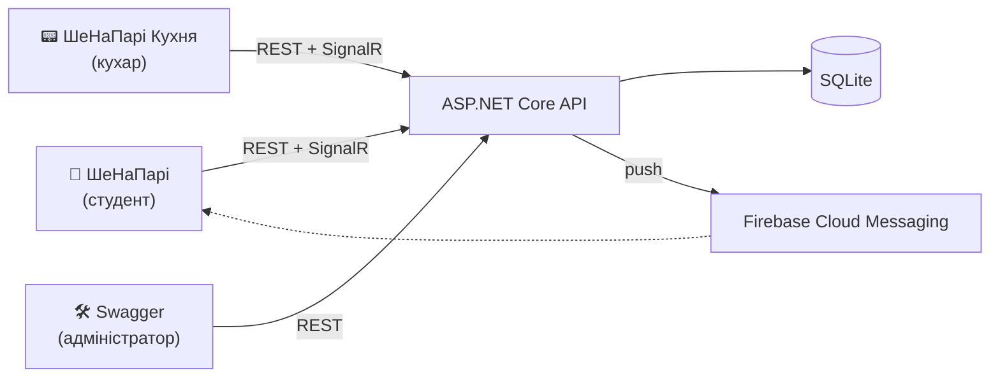

<div align="center">

# ШеНаПарі

**Замов їжу в університетській їдальні під час пари й забери її на перерві за QR-кодом, без черги.**

[](https://github.com/Vlad200815/SheNaPari/actions/workflows/backend-ci.yml)
[](https://github.com/Vlad200815/SheNaPari/actions/workflows/mobile-ci.yml)


</div>

---

## Про проєкт

Перерва між парами триває 10 хвилин, а черга в їдальні довша. ШеНаПарі прибирає чергу з цього процесу:

1. Студент обирає страви в застосунку, вказує перерву, на якій забере замовлення (або «якнайшвидше»), і оплачує.
2. Кухня одразу бачить замовлення на планшеті, приймає його й обіцяє час готовності.
3. Коли страва готова, студент отримує сповіщення, приходить на видачу й показує QR-код.
4. Кухар сканує код, і замовлення видано.

Система складається з трьох частин:

| Частина | Для кого | Де в репозиторії |
|---|---|---|
| **ШеНаПарі**: мобільний застосунок клієнта (iOS, Android) | студенти | [`mobile/shenapari`](mobile/shenapari) |
| **ШеНаПарі Кухня**: застосунок персоналу (Android-планшет або телефон) | кухарі | [`mobile/kitchen`](mobile/kitchen) |
| **API**: сервер на ASP.NET Core | обидва застосунки; адміністратор працює через Swagger | [`backend`](backend) |

Спільний для обох застосунків код (мережа, сесія, тема, SignalR) винесено в пакет [`mobile/packages/shenapari_core`](mobile/packages/shenapari_core).



## Можливості

**Студент**
- Вхід за номером телефону й SMS-кодом, без пароля.
- Меню з категоріями, «Популярне», фото, КБЖВ, позначками «гостре» та «веган». Страви, що закінчились, показано сірими.
- Кошик, вибір перерви або «якнайшвидше», імітація оплати через Google Pay або Apple Pay.
- Статус замовлення в реальному часі (прийнято, готується, готово) і час готовності від кухні.
- «Мій QR»: код для видачі на максимальній яскравості, скриншоти заборонено.
- Push-сповіщення на Android і стрічка сповіщень під дзвіночком.
- Скасування до початку приготування з поверненням коштів.
- Історія замовлень з підсумками за місяць і фільтрами.
- Оцінка замовлення (1–5 зірок, теги, коментар) протягом 3 днів після видачі.
- Українська та англійська мови, світла й темна теми, вимкнення анімацій, видалення акаунта.

**Кухня**
- Черга у трьох колонках («Нові», «Готуються», «Готові») зі звуком на кожне нове замовлення.
- «Прийняти · 5/10/15/20 хв», «Готово», скасування з причиною, яку побачить клієнт.
- Видача: QR-код сканується камерою, або замовлення шукають за номером.
- Стоп-лист: «закінчилось» для страви одним дотиком, «Увімкнути все» зранку.
- Пауза прийому замовлень, коли кухня перевантажена.

**Адміністратор** (через Swagger)
- Меню: категорії, страви, ціни, фото, англійські назви.
- Розклади дзвінків: кілька розкладів, один з них активний, перерви генеруються на 7 днів уперед.
- Акаунти персоналу: створення, вимкнення, зміна пароля.
- Усі замовлення за день з історією статусів.

## Стек

| Шар | Технології |
|---|---|
| Сервер | ASP.NET Core (.NET 10), EF Core 10, SQLite, SignalR, JWT, Firebase Admin SDK (FCM), Swagger |
| Мобільні застосунки | Flutter, Dart 3.10, flutter_bloc (Cubit), go_router, get_it, Dio + Retrofit, freezed, easy_localization, signalr_netcore |
| Тести | xUnit + WebApplicationFactory (сервер), flutter_test, bloc_test, mocktail |
| CI | GitHub Actions: збірка з `-warnaserror`, тести, перевірка міграцій і вразливих пакетів; `flutter analyze` і `flutter test` для обох застосунків |

Подробиці в [документі з архітектури](docs/architecture.md).

## Швидкий старт

Потрібні [.NET SDK 10](https://dotnet.microsoft.com/download) і [Flutter](https://docs.flutter.dev/get-started/install) (канал stable, Dart ≥ 3.10).

**1. Сервер**

```bash
cd backend
dotnet run --project src/ShenaPari.Api
```

Swagger відкриється на http://localhost:5041/swagger. Під час першого запуску створюється база SQLite з демо-меню, розкладами дзвінків і тестовими акаунтами.

**2. Застосунок клієнта**

```bash
cd mobile
flutter pub get
(cd packages/shenapari_core && dart run build_runner build -d)
cd shenapari
dart run build_runner build -d
flutter run --dart-define-from-file=env/dev.json
```

Без `API_BASE_URL` застосунок звертається до комп'ютера розробника: з Android-емулятора на `10.0.2.2:5041`, з iOS-симулятора на `localhost:5041`.

**3. Застосунок кухні**

```bash
cd mobile/kitchen
dart run build_runner build -d
flutter run
```

**Тестові акаунти** (лише в режимі розробки):

| Роль | Вхід | Пароль |
|---|---|---|
| Клієнт | будь-який номер `+380XXXXXXXXX` | SMS-код з'являється в консолі сервера |
| Кухар | `cook@shenapari.local` | `Cook12345!` |
| Суперадмін | `superadmin@shenapari.local` | `SuperAdmin123!` |

Запуск на справжньому телефоні, демо через ngrok, тести й CI описано в [посібнику розробника](docs/development.md).

## Документація

| Документ | Зміст |
|---|---|
| [Архітектура](docs/architecture.md) | стек, шари, структура папок, потоки даних (вхід, реальний час, push) |
| [База даних](docs/database.md) | ER-діаграма, усі таблиці з полями, типами й обмеженнями |
| [API](docs/api.md) | усі ендпоінти з ролями й тілами запитів, події SignalR, коди помилок |
| [Сценарії користувачів](docs/user-scenarios.md) | як студент, кухар і адміністратор виконують свої задачі |
| [Стан проєкту](docs/status.md) | що реалізовано, що ні і що спрощено в MVP |
| [Розробка](docs/development.md) | запуск, конфігурація, тести, CI, демо з будь-якої мережі |

## Структура репозиторію

```
SheNaPari/
├── backend/                  ASP.NET Core API та інтеграційні тести
├── mobile/
│   ├── pubspec.yaml          Flutter workspace: обидва застосунки й пакет
│   ├── shenapari/            застосунок клієнта
│   ├── kitchen/              застосунок кухні
│   └── packages/
│       └── shenapari_core/   спільний код
├── docs/                     документація
├── scripts/demo.sh           сервер і ngrok-тунель для демо
└── .github/workflows/        CI для сервера й мобільних застосунків
```

## Ліцензія

[MIT](LICENSE) © 2026 Vlad Semeniuk

Анімація зірок оцінки: «Rating animation» від JcToon, [CC BY 4.0](https://creativecommons.org/licenses/by/4.0/).
