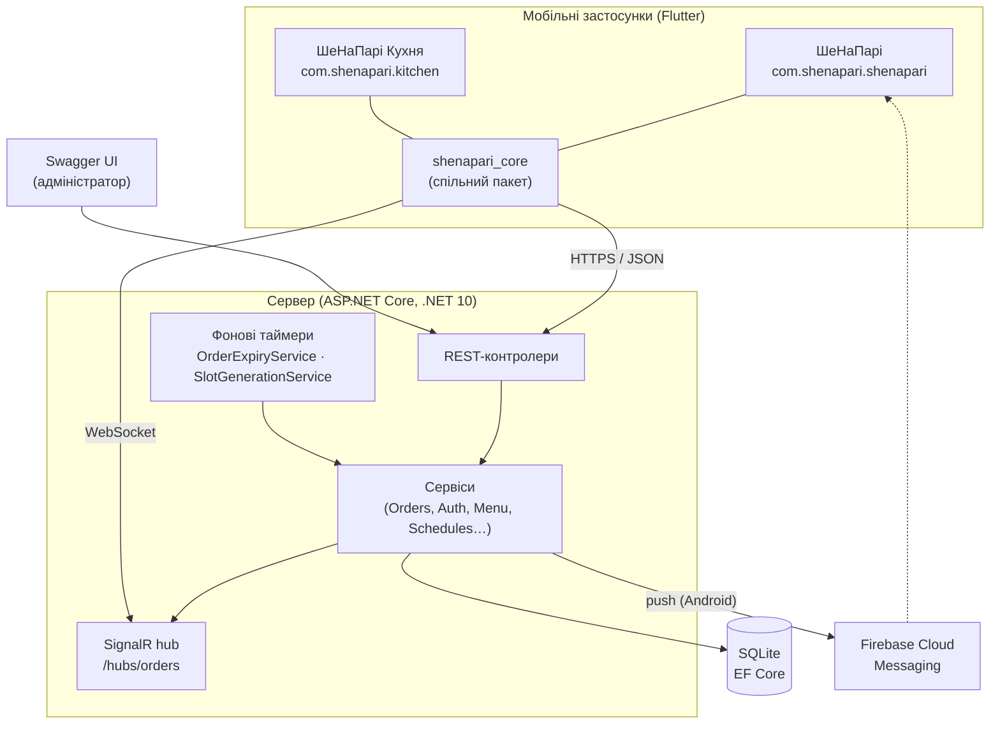
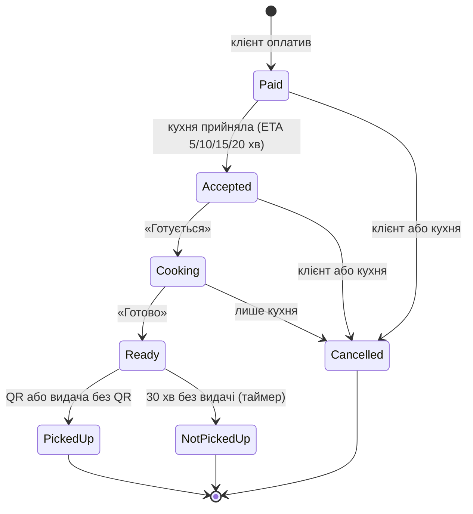
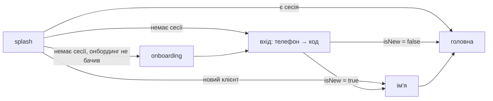
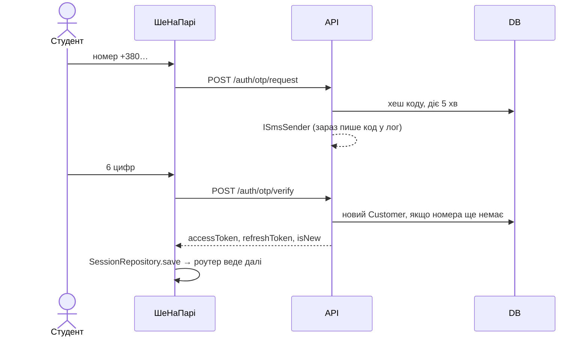
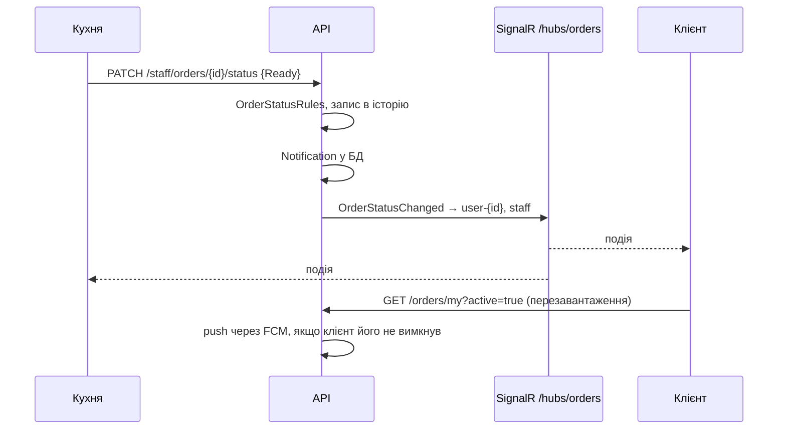

# Архітектура

[← До README](../README.md)

- [Загальна схема](#загальна-схема)
- [Стек технологій](#стек-технологій)
- [Сервер](#сервер)
- [Мобільні застосунки](#мобільні-застосунки)
- [Структура папок](#структура-папок)
- [Ключові потоки даних](#ключові-потоки-даних)
- [Безпека](#безпека)

## Загальна схема



Сервер — єдине джерело правди: ціни, статуси, права й час рахуються на ньому, клієнт лише показує результат і не дублює правил.

## Стек технологій

### Сервер (`backend/`)

| Що | Технологія | Навіщо |
|---|---|---|
| Фреймворк | ASP.NET Core, .NET 10 | REST API, DI, middleware |
| ORM | Entity Framework Core 10 | моделі, міграції (14 штук у `Migrations/`) |
| База | SQLite | один файл `shenapari.db`, нуль налаштувань для курсової |
| Реальний час | SignalR | статуси замовлень, пауза кухні, зміни меню |
| Автентифікація | JWT Bearer (HMAC-SHA256) + refresh-токени | короткий access (15 хв), довгий refresh (30 днів) з ротацією |
| Паролі | `PasswordHasher` з ASP.NET Core Identity | PBKDF2 із сіллю |
| Push | FirebaseAdmin 3.7 (FCM HTTP v1) | сповіщення на Android |
| Документація API | Swashbuckle (Swagger UI) | заодно адмін-панель для MVP |
| Обмеження запитів | вбудований `RateLimiter` | 20 запитів на хвилину з однієї IP на `/auth/*` |
| Тести | xUnit, `WebApplicationFactory` | справжній API в пам'яті на тимчасовій SQLite |

### Мобільні застосунки (`mobile/`)

| Що | Пакет | Навіщо |
|---|---|---|
| UI | Flutter, `material_ui` | iOS і Android з одного коду |
| Стан | `flutter_bloc` (Cubit) | стан екрана; стан описано через `freezed` |
| Навігація | `go_router` | декларативні маршрути, redirect за статусом сесії |
| DI | `get_it` | service locator, по модулю на фічу |
| Мережа | `dio` + `retrofit` | HTTP-клієнт, згенеровані API-інтерфейси |
| Серіалізація | `json_serializable`, `freezed` | DTO й незмінні стани |
| Реальний час | `signalr_netcore` | підключення до `/hubs/orders` |
| Сховище | `flutter_secure_storage`, `shared_preferences` | токени (Keychain/Keystore) і прапорці |
| Локалізація | `easy_localization` | українська й англійська (кухня лише українською) |
| Push | `firebase_messaging`, `flutter_local_notifications` | лише Android |
| QR | `qr_flutter` (клієнт), `mobile_scanner` (кухня) | показ і сканування коду видачі |
| Пристрій | `screen_brightness`, `wakelock_plus`, `no_screenshot` | режим показу QR |
| Анімація | `rive` | зірки оцінки |
| Звук | `audioplayers` | «дзинь» при оплаті, видачі й новому замовленні |
| Тести | `flutter_test`, `bloc_test`, `mocktail` | Cubit, use case, DTO, віджети |
| Генерація | `build_runner`, `flutter_gen` | код для freezed/retrofit/json, класи ресурсів і кольорів |

## Сервер

### Шари

Сервер побудований як один проєкт `ShenaPari.Api`, поділений на папки за предметними областями. Контролери тонкі: читають запит, викликають сервіс, перетворюють результат на HTTP-відповідь.

```
HTTP → Controller → Service → AppDbContext (EF Core) → SQLite
                       ↓
                 OrderNotifier → SignalR / PushService → FCM
```

### Конверт відповіді `Result<T>`

Кожна відповідь, успішна чи ні, має одну форму, а HTTP-статус при цьому справжній:

```json
{ "succeeded": true,  "message": null, "data": { "...": "..." }, "errors": [] }
{ "succeeded": false, "message": "Замовлення ще не готове", "data": null, "errors": ["order.not_ready"] }
```

- `message` — текст для людини мовою запиту (`Accept-Language: uk|en`).
- `errors[0]` — стабільний машинний код. Усі коди зібрані в `Common/Errors.cs`, переклади в `Common/ErrorTexts.cs`.
- У цей самий конверт загорнуті 401/403 від middleware автентифікації, 404 на невідомий шлях, 429 від rate limiter, 400 на зламаний JSON і 500 на необроблений виняток (`Program.cs`).

Сервіси повертають `Result<T>` замість винятків. Неявні перетворення дозволяють писати `return dto;` або `return OrderErrors.NotReady;`.

### Модулі

| Папка | Відповідальність |
|---|---|
| `Auth/` | OTP-вхід, вхід персоналу, видача й ротація токенів, хешування паролів, політики ролей |
| `Employees/` | акаунти персоналу: хто ким може керувати |
| `Menu/` | CRUD категорій і страв, завантаження фото в `wwwroot/images/dishes` |
| `Schedules/` | розклади дзвінків, генерація перерв, «годинник кампусу» (часовий пояс Europe/Kyiv) |
| `Orders/` | створення, правила статусів, видача за QR, оцінки, сповіщення, SignalR hub, таймер |
| `Canteens/` | перемикач «приймаємо / пауза» |
| `Push/` | відправка push через FCM, прив'язка токена пристрою до сесії |
| `Legal/` | умови, політика конфіденційності, умови повернення коштів (Markdown, вбудовані в збірку) |
| `Common/` | `Result`, коди помилок, тексти, вибір мови |
| `Controllers/`, `Dtos/`, `Entities/`, `Data/` | HTTP-шар, моделі API, таблиці, контекст і наповнення бази |

### Фонові задачі

| Сервіс | Як часто | Що робить |
|---|---|---|
| `SlotGenerationService` | щогодини | створює перерви (`BreakSlots`) з активного розкладу на 7 днів уперед |
| `OrderExpiryService` | щохвилини | закриває як «не забрано» замовлення, що чекають у статусі «готово» понад 30 хв; через 30 хв після видачі один раз просить оцінити замовлення |

Інтервали задаються в секціях `Orders` і `Campus` файлу `appsettings.json`.

### Життєвий цикл замовлення



Правила переходів зібрані в одному місці, `Orders/OrderStatusRules.cs`. Сервер перевіряє кожен перехід; неможливий (наприклад, `Paid → Ready`) повертає 409 `order.invalid_transition`. Кожна зміна пише рядок в `OrderStatusChanges`: статус, хто змінив, коли й чому. Скасування переводить оплату в `Refunded`. «Не забрано» коштів не повертає.

Застосунок кухні робить «Прийняти» і «Готується» одним дотиком: після `accept` одразу надсилає `status: Cooking`.

## Мобільні застосунки

### Flutter workspace

`mobile/pubspec.yaml` — корінь [pub workspace](https://dart.dev/tools/pub/workspaces) з трьох учасників. Одна команда `flutter pub get` розв'язує залежності для всіх.

| Учасник | Що всередині |
|---|---|
| `shenapari` | застосунок клієнта |
| `kitchen` | застосунок кухні |
| `packages/shenapari_core` | спільне: `network/`, `result/`, `session/`, `storage/`, `orders/` (статуси й SignalR), `l10n/`, `ui/` (тема, кольори, кнопки, шторки, лого) |

### Clean Architecture, feature-first

Кожна фіча має три шари, залежності йдуть усередину: `presentation → domain ← data`.

```
features/<фіча>/
  data/            Retrofit API, *Dto з toEntity(), *RepositoryImpl
  domain/          сутності, інтерфейс репозиторію, use cases (чистий Dart)
  presentation/    *_cubit.dart, *_state.dart, *_page.dart, widgets/
  <фіча>_module.dart   реєстрація в get_it
```

Правила, яких дотримується код:

- **domain** не знає про Flutter, Dio чи JSON. DTO не виходять за межі `data/`.
- **Репозиторії** повертають `Result<T>` (`Ok` або `Err(Failure)`) і не кидають винятків. Конверт розпаковує лише `apiCall` у `shenapari_core/network`.
- **Тип помилки** визначається HTTP-статусом: 400 `ValidationFailure`, 401 `UnauthorizedFailure`, 403 `ForbiddenFailure`, 404 `NotFoundFailure`, 409 `ConflictFailure`, решта `ServerFailure`; без відповіді `NetworkFailure`. Екран реагує на тип або на `failure.code`, ніколи на текст.
- **Енуми з API** мають значення `unknown` і розбираються через `values.asNameMap()[s] ?? unknown`, тож нове значення на сервері не ламає старий застосунок.
- **Use case** з'являється лише там, де є кілька кроків: `GetMenuUseCase` паралельно вантажить їдальню, категорії, страви й наступну перерву; `VerifyCodeUseCase` перевіряє код і зберігає сесію.
- **Cubit** реєструється як `registerFactory`, не тримає `BuildContext` і не дублює полів стану.
- **Ціни** зберігаються в копійках (`int`), щоб суми в кошику були точними.

### Сесія й навігація

`SessionRepository` — єдине джерело правди про вхід. Статуси: `unknown → unauthenticated | needsProfile | authenticated`. Роутер слухає ці зміни й сам вирішує, куди вести (`app/router/app_redirect.dart`, чиста функція з тестами). Після входу чи виходу жоден екран не викликає `context.go` вручну.



На iOS Keychain переживає видалення застосунку, тому під час першого запуску після встановлення `bootstrap` очищує сховище токенів.

### Екрани клієнта

Нижня панель: **Головна · Кошик · [Мій QR] · Замовлення · Більше**. Кругла кнопка в центрі відкриває QR активного замовлення й світиться, коли щось готове. Решта екранів відкривається поверх вкладок:

| Маршрут | Екран |
|---|---|
| `/onboarding` | три вітальні слайди; на останньому запит дозволу на сповіщення |
| `/auth/phone`, `/auth/code` | вхід за номером і кодом |
| `/registration-profile` | ім'я нового клієнта |
| `/home` | меню, картка наступної перерви, картка «Як вам №…?» |
| `/dish/:id` | страва: фото, опис, КБЖВ, кількість |
| `/cart` | кошик |
| `/checkout` | вибір перерви, спосіб оплати, «Оплатити» |
| `/orders` | «Активні» та «Історія» з фільтрами й підсумками за місяць |
| `/order/:id` | замовлення: кроки статусу наживо, QR, скасування, оцінка |
| `/my-qr` | шторка з QR (або кількома, якщо замовлень декілька) |
| `/notifications` | сповіщення від кухні |
| `/more`, `/profile`, `/settings`, `/faq`, `/support` | профіль, налаштування, допомога |
| `/legal/:type` | умови, політика конфіденційності, повернення коштів |

### Екрани кухні

Маршрути: `/` (splash), `/login`, `/queue`. На `/queue` три вкладки: **Черга**, **Видача**, **Стоп-лист**. Головний пристрій — Android-планшет горизонтально (три колонки), на телефоні той самий інтерфейс вертикально (один статус за раз). Тема завжди темна.

## Структура папок

```
SheNaPari/
├── backend/
│   ├── ShenaPari.slnx
│   ├── secrets/                       ключ Firebase (у .gitignore)
│   ├── src/ShenaPari.Api/
│   │   ├── Program.cs                 DI, JWT, SignalR, rate limit, Swagger, обробка помилок
│   │   ├── appsettings*.json          конфігурація (JWT, Campus, Orders, Firebase, Seed)
│   │   ├── Auth/  Canteens/  Common/  Employees/  Legal/  Menu/  Orders/  Push/  Schedules/
│   │   ├── Controllers/               15 контролерів
│   │   ├── Dtos/                      моделі запитів і відповідей
│   │   ├── Entities/                  таблиці бази
│   │   ├── Data/                      AppDbContext, DbSeeder (демо-меню, розклади, персонал)
│   │   ├── Migrations/                міграції EF Core
│   │   └── wwwroot/images/            фото страв (демо й завантажені)
│   └── tests/ShenaPari.Api.Tests/     інтеграційні тести
│
├── mobile/
│   ├── pubspec.yaml                   workspace
│   ├── packages/shenapari_core/lib/
│   │   ├── core_module.dart           реєстрація спільних сервісів
│   │   ├── network/                   Dio, AuthInterceptor, LanguageInterceptor, ApiEnvelope, apiCall
│   │   ├── result/                    Result<T>, Failure
│   │   ├── session/                   SessionRepository, SessionCubit, токени
│   │   ├── storage/                   SecureTokenStorage, AppPrefs
│   │   ├── orders/                    OrderStatus, OrderEvents, SignalROrderEvents
│   │   ├── l10n/                      мова застосунку, CoreKeys
│   │   └── ui/                        тема, кольори, AppText, AppButton, шторки, снекбари
│   │
│   ├── shenapari/
│   │   ├── env/                       dev.json, *.example.json (device.json і demo.json — локальні)
│   │   ├── assets/                    зображення, переклади, legal/*.md, rive, звуки
│   │   ├── tool/                      скрипти підготовки звуків і зображень
│   │   ├── lib/
│   │   │   ├── main.dart              лише bootstrap()
│   │   │   ├── app/                   bootstrap, DI, env, роутер, нижня панель, splash
│   │   │   ├── core/device/           режим QR, дозвіл на сповіщення, push, звук
│   │   │   └── features/
│   │   │       ├── auth/              вхід за телефоном і кодом
│   │   │       ├── cart/              локальний кошик (SharedPreferences)
│   │   │       ├── legal/             документи з кешем і офлайн-копією
│   │   │       ├── menu/              головна, страва
│   │   │       ├── notifications/     стрічка сповіщень
│   │   │       ├── onboarding/        вітальні слайди
│   │   │       ├── orders/            оформлення, замовлення, історія, «Мій QR», оцінка
│   │   │       ├── profile/           профіль, налаштування, FAQ, підтримка, видалення акаунта
│   │   │       └── push/              реєстрація токена, відкриття замовлення з push
│   │   └── test/                      дзеркалить lib/
│   │
│   └── kitchen/
│       ├── lib/
│       │   ├── app/                   bootstrap, DI, роутер
│       │   ├── core/                  звуки, KitchenButton
│       │   └── features/
│       │       ├── auth/              вхід персоналу (email + пароль)
│       │       ├── queue/             черга, деталі, скасування
│       │       ├── pickup/            сканер QR і пошук за номером
│       │       ├── stop_list/         доступність страв
│       │       └── canteen/           пауза прийому
│       └── test/
│
├── scripts/demo.sh                    сервер + ngrok
├── .run/                              конфігурації запуску для Android Studio
└── .github/workflows/                 backend-ci.yml, mobile-ci.yml
```

## Ключові потоки даних

### Вхід клієнта



Обмеження: новий код не частіше ніж раз на 60 с, 5 спроб на один код, 20 запитів на хвилину з однієї IP на всі `/auth/*`.

### Оновлення токена

`AuthInterceptor` (у `shenapari_core`) додає `Authorization: Bearer …` до кожного запиту. На 401 він робить **один спільний** `POST /auth/refresh` для всіх паралельних запитів, бо сервер обертає refresh-токени й повторне оновлення зі старим токеном не вдалося б. Якщо сервер відхилив refresh (400/401/403), сесія очищується й роутер веде на вхід. Якщо мережі немає, сесія зберігається.

### Реальний час



Під час підключення hub додає кожне з'єднання в групу `user-{id}`, а персонал ще й у групу `staff`. Токен передається як `?access_token=…`, бо WebSocket не вміє надсилати заголовок. Подія лише каже, що щось змінилось, а актуальні дані застосунок бере через REST. Після перепідключення застосунки перезавантажують усе, що показують, бо події за час відсутності зв'язку втрачено.

### Push-сповіщення

- Токен пристрою зберігається на сесії (`RefreshTokens.PushToken`), тож вихід з акаунта зупиняє сповіщення на цьому пристрої. Один телефон відповідає одному акаунту: новий вхід забирає токен у попередньої сесії.
- Сповіщення надходять про `Accepted`, `Ready`, `Cancelled` (якщо скасував не сам клієнт), `NotPickedUp` і прохання оцінити. Текст пишеться мовою, якою оформлено замовлення (`Orders.Language`).
- Кожне сповіщення також зберігається в `Notifications`, тож стрічка під дзвіночком працює і на iOS, і з вимкненим push.
- Канал Android `order_updates` зі звуком `gam`. Тап по сповіщенню відкриває `/order/{id}`, а прохання оцінити — `/order/{id}?rate=1`.
- Без ключа Firebase сервер працює, а push лише пише в лог (`LogPushSender`).

### Мова

Застосунок надсилає `Accept-Language` з кожним запитом (`LanguageInterceptor`). Сервер відповідає цією мовою: тексти помилок, документи `/legal/*`, назви страв і категорій (`NameEn`, якщо адміністратор його заповнив). Позиції замовлення зберігають обидві назви, тож історія показується мовою запиту.

## Безпека

| Загроза | Захист |
|---|---|
| Перебір SMS-кодів | 5 спроб на код, код живе 5 хв, у базі лише SHA-256 хеш (з номером як сіллю), порівняння за сталий час |
| Спам кодами | 60 с між кодами для номера, 20 запитів на хвилину з однієї IP на `/auth/*` |
| Перебір паролів персоналу | та сама межа запитів; однакова помилка для «немає такого email» і «невірний пароль» |
| Витік бази | паролі як PBKDF2, refresh-токени й коди лише як хеші |
| Вимкнений працівник з дійсним токеном | токен персоналу перевіряється в базі на кожному запиті; вимкнення відкликає всі сесії |
| Підробка ціни | ціну й назву сервер бере зі своєї бази, а не з запиту |
| Чуже замовлення | інший клієнт отримує 404, а не 403, щоб не розкривати існування id |
| Передача QR-коду | у QR лише випадковий 128-бітний `PickupToken`; сервер надсилає його, лише поки замовлення готове; екран QR забороняє скриншоти |
| Секрети в репозиторії | ключ Firebase у `backend/secrets/` (у `.gitignore`); JWT-ключ у `appsettings.json` відсутній, а `appsettings.Development.json` містить лише ключ для розробки |
