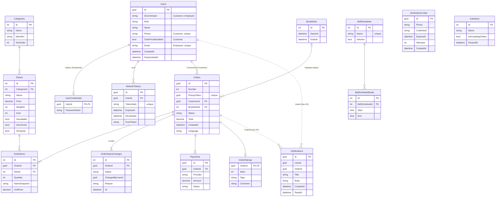

# База даних

[← До README](../README.md)

СУБД — **SQLite** (файл `backend/src/ShenaPari.Api/shenapari.db`), доступ через **EF Core 10** (code-first). Схему описують класи в `Entities/` і конфігурація в `Data/AppDbContext.cs`. Під час старту сервер сам застосовує міграції (`Database.MigrateAsync()` у `DbSeeder`), тож щоб почати з чистої бази, достатньо видалити файл.

- [ER-діаграма](#er-діаграма)
- [Як зберігаються типи](#як-зберігаються-типи)
- [Таблиці](#таблиці): користувачі й вхід · меню · розклад · замовлення · сповіщення · їдальня
- [Початкові дані](#початкові-дані)
- [Міграції](#міграції)

## ER-діаграма



На діаграмі для стислості показано не всі поля. Повний перелік наведено в таблицях нижче.

## Як зберігаються типи

SQLite не має власних типів для дати й грошей, тому `AppDbContext.ConfigureConventions` перетворює їх так, щоб їх можна було порівнювати й сортувати в SQL:

| Тип у C# | Колонка SQLite | Примітка |
|---|---|---|
| `Guid` | `TEXT` | |
| `int`, `bool` | `INTEGER` | |
| `string` | `TEXT` | довжину обмежує EF (`HasMaxLength`) |
| `DateTimeOffset` | `INTEGER` | `DateTimeOffsetToBinaryConverter`; усі значення в UTC |
| `decimal` | `REAL` | ціни з 2 знаками після коми |
| `TimeOnly` | `TEXT` | час перерви за місцевим часом кампусу (`"13:00:00"`) |
| енуми `Role`, `Status`, `Provider` | `TEXT` | назва значення (`"Ready"`), до 20 символів |

Позначення в таблицях нижче: **PK** — первинний ключ, **FK** — зовнішній ключ, **U** — унікальний індекс, **I** — звичайний індекс, `?` — може бути `NULL`.

## Таблиці

### Користувачі й вхід

#### `Users`

Усі, хто може увійти. Одна таблиця на ієрархію класів (TPH): абстрактний `User` і два нащадки, `Customer` та `Employee`. Колонка `Discriminator` вказує, який клас зберігає рядок.

| Поле | Тип | Обмеження | Опис |
|---|---|---|---|
| `Id` | Guid | PK | |
| `Discriminator` | string | | `Customer` або `Employee` |
| `Role` | enum → text(20) | | `Customer`, `Cook`, `Admin`, `SuperAdmin` |
| `Name` | string(100)? | | ім'я, яке кухня називає на видачі; `NULL`, поки клієнт його не ввів |
| `CreatedAt` | DateTimeOffset | | |
| `DeactivatedAt` | DateTimeOffset? | | вимкнений акаунт (персонал) або видалений (клієнт) не може увійти |
| `Phone` | string(20) | U, лише `Customer` | логін клієнта, `+380XXXXXXXXX` |
| `OrderPushEnabled` | bool | лише `Customer`, типово `true` | push про власні замовлення |
| `Email` | string(200) | U, лише `Employee` | логін персоналу, у нижньому регістрі |

Ролі вкладені: `SuperAdmin` ⊃ `Admin` ⊃ `Cook`, `Customer` окремо. Унікальні індекси ігнорують `NULL`, тому клієнти без email і працівники без телефону живуть в одній таблиці.

Коли клієнт видаляє акаунт, рядок не зникає: ім'я стирається, телефон замінюється на `del-<id>`, ставиться `DeactivatedAt`. Замовлення лишаються знеособленими, а той самий номер може зареєструватися знову.

#### `UserCredentials`

Пароль працівника, окремо від рядка користувача.

| Поле | Тип | Обмеження | Опис |
|---|---|---|---|
| `UserId` | Guid | PK, FK → `Users.Id` (cascade) | |
| `PasswordHash` | string | | PBKDF2 з випадковою сіллю (`PasswordHasher<Employee>`) |

#### `VerificationCodes`

Одноразові SMS-коди для входу клієнта. На один номер існує лише один живий код.

| Поле | Тип | Обмеження | Опис |
|---|---|---|---|
| `Id` | Guid | PK | |
| `Phone` | string(20) | I | |
| `CodeHash` | string | | SHA-256 від `"{phone}:{code}"`, сам код не зберігається |
| `ExpiresAt` | DateTimeOffset | | через 5 хв після створення |
| `Attempts` | int | | невдалі спроби; після 5 код блокується |
| `CreatedAt` | DateTimeOffset | | для паузи 60 с між кодами |

#### `RefreshTokens`

Одна сесія на одному пристрої.

| Поле | Тип | Обмеження | Опис |
|---|---|---|---|
| `Id` | Guid | PK | потрапляє в access-токен як claim `sid` |
| `UserId` | Guid | FK → `Users.Id` (cascade), I | |
| `TokenHash` | string | U | SHA-256 від токена; сам токен знає лише застосунок |
| `ExpiresAt` | DateTimeOffset | | через 30 днів |
| `RevokedAt` | DateTimeOffset? | | вихід, ротація, вимкнення або зміна пароля |
| `PushToken` | string(500)? | I | токен Firebase пристрою, на якому відкрита ця сесія |

### Меню

#### `Categories`

| Поле | Тип | Обмеження | Опис |
|---|---|---|---|
| `Id` | int | PK | |
| `Name` | string(100) | | українська назва |
| `NameEn` | string(100)? | | англійська; `NULL` означає показувати українську |
| `SortOrder` | int | | порядок вкладок у меню |

#### `Dishes`

| Поле | Тип | Обмеження | Опис |
|---|---|---|---|
| `Id` | int | PK | |
| `CategoryId` | int | FK → `Categories.Id` (cascade), I | |
| `Name` | string(200) | | |
| `Description` | string? | | до 1000 символів (перевіряє сервіс) |
| `NameEn`, `DescriptionEn` | string? | | англійські тексти |
| `Price` | decimal(10,2) | | > 0 і ≤ 100 000 |
| `WeightG` | int | | вага порції, г |
| `Kcal` | int | | калорійність порції |
| `ProteinG`, `FatG`, `CarbsG` | int? | | білки, жири, вуглеводи, г; `NULL`, поки кухня їх не вказала |
| `SpicyLevel` | int | | 0 не гостре … 3 дуже гостре |
| `IsVegan` | bool | | без продуктів тваринного походження |
| `ImageUrl` | string? | | відносний шлях: `/images/menu/…` (демо) або `/images/dishes/…` (завантажене) |
| `IsAvailable` | bool | типово `true` | стоп-лист кухні: `false` означає «закінчилось», страву видно сірою |
| `IsArchived` | bool | | видалена адміністратором, але є в минулих замовленнях; не видна нікому |
| `IsPopular` | bool | | показується у вкладці «Популярне» |

Страву, яку хоч раз замовляли, не можна видалити фізично (на неї посилаються `OrderItems`), тому `DELETE` її архівує.

### Розклад дзвінків і перерви

#### `BellSchedules`

Іменований розклад («Основний», «Скорочений»). Активний завжди лише один.

| Поле | Тип | Обмеження | Опис |
|---|---|---|---|
| `Id` | int | PK | |
| `Name` | string(100) | U | |
| `IsActive` | bool | | з нього генеруються перерви |

#### `BellScheduleBreak`

Одна перерва розкладу без дати.

| Поле | Тип | Обмеження | Опис |
|---|---|---|---|
| `Id` | int | PK | |
| `BellScheduleId` | int | FK → `BellSchedules.Id` (cascade), I | |
| `Start`, `End` | TimeOnly | | місцевий час кампусу; перерви не перетинаються, `End > Start`, до 20 на розклад |

#### `BreakSlots`

Конкретна перерва конкретного дня. Генерується з активного розкладу на 7 днів уперед (під час старту, щогодини й після перемикання розкладу).

| Поле | Тип | Обмеження | Опис |
|---|---|---|---|
| `Id` | int | PK | |
| `StartsAt` | DateTimeOffset | I | UTC, перераховано з часового поясу `Europe/Kyiv` з урахуванням літнього часу |
| `EndsAt` | DateTimeOffset | | |

Після перемикання розкладу майбутні перерви, на які ще ніхто не замовив, видаляються й створюються заново. Перерви з замовленнями лишаються, тож клієнти не втрачають свій час видачі.

### Замовлення

#### `Orders`

| Поле | Тип | Обмеження | Опис |
|---|---|---|---|
| `Id` | Guid | PK | |
| `Number` | int | | короткий номер («№7»), щодня починається з 1 |
| `PickupToken` | Guid | U | випадкові 128 біт; єдине, що закодовано в QR |
| `CustomerId` | Guid | FK → `Users.Id` (cascade), I | |
| `BreakSlotId` | int? | FK → `BreakSlots.Id`, I | `NULL` означає «якнайшвидше» |
| `Status` | enum → text(20) | I | `Paid`, `Accepted`, `Cooking`, `Ready`, `PickedUp`, `Cancelled`, `NotPickedUp` |
| `Total` | decimal(10,2) | | рахує сервер з позицій |
| `CreatedAt` | DateTimeOffset | I | |
| `EstimatedReadyAt` | DateTimeOffset? | | ставить кухар під час прийняття: зараз + 5/10/15/20 хв, але не раніше за початок обраної перерви |
| `ReadyAt` | DateTimeOffset? | | від цього моменту йде таймер «не забрано» (30 хв) |
| `PickedUpAt` | DateTimeOffset? | I | від цього моменту йдуть таймери оцінки |
| `RatingAskedAt` | DateTimeOffset? | | push «Як вам №…?» уже надіслано (один раз на замовлення) |
| `RatingDismissedAt` | DateTimeOffset? | | клієнт закрив картку оцінки на головній |
| `Language` | string | типово `"uk"` | `uk` або `en`; мова застосунку під час оформлення, нею пишуться пізніші сповіщення |

#### `OrderItems`

| Поле | Тип | Обмеження | Опис |
|---|---|---|---|
| `Id` | int | PK | |
| `OrderId` | Guid | FK → `Orders.Id` (cascade), I | |
| `DishId` | int | FK → `Dishes.Id` (cascade), I | |
| `Quantity` | int | | 1–20 |
| `NameSnapshot` | string(200) | | назва на момент замовлення |
| `NameEnSnapshot` | string(200)? | | англійська назва на момент замовлення |
| `UnitPrice` | decimal(10,2) | | ціна на момент замовлення |

Знімки назви й ціни потрібні, щоб пізніші зміни меню не переписували історію.

#### `OrderStatusChanges`

Історія замовлення: кожна зміна статусу.

| Поле | Тип | Обмеження | Опис |
|---|---|---|---|
| `Id` | int | PK | |
| `OrderId` | Guid | FK → `Orders.Id` (cascade), I | |
| `Status` | enum → text(20) | | статус, який отримало замовлення |
| `ChangedByUserId` | Guid? | | клієнт або працівник; `NULL` означає систему (таймер) |
| `Reason` | string(300)? | | причина скасування від кухні або «Не забрано протягом 30 хв» |
| `At` | DateTimeOffset | | |

#### `Payments`

Оплата імітується: справжні гроші не рухаються.

| Поле | Тип | Обмеження | Опис |
|---|---|---|---|
| `Id` | Guid | PK | |
| `OrderId` | Guid | FK → `Orders.Id` (cascade), I | |
| `Provider` | enum → text(20) | | `GooglePay` або `ApplePay` |
| `Amount` | decimal(10,2) | | дорівнює `Orders.Total` |
| `Status` | enum → text(20) | | `Paid`; після скасування `Refunded` |
| `CreatedAt` | DateTimeOffset | | |
| `PaidAt` | DateTimeOffset? | | |

#### `OrderRatings`

Оцінка виданого замовлення: одна на замовлення, її можна змінювати 3 дні.

| Поле | Тип | Обмеження | Опис |
|---|---|---|---|
| `OrderId` | Guid | PK, FK → `Orders.Id` (cascade) | |
| `Stars` | int | | 1–5 |
| `Tags` | string(200) | | коди через кому в порядку вибору. На 4–5 зірок: `tasty`, `fast`, `hot`, `big_portion`, `no_queue`; на 1–3: `cold`, `slow`, `small_portion`, `wrong_order`, `not_tasty` |
| `Comment` | string(500)? | | |
| `CreatedAt`, `UpdatedAt` | DateTimeOffset | | |

### Сповіщення

#### `Notifications`

Те, що кухня повідомила клієнту про замовлення: стрічка під дзвіночком. Ті самі тексти йдуть як push, але запис у стрічці лишається, навіть якщо push вимкнено чи він не дійшов.

| Поле | Тип | Обмеження | Опис |
|---|---|---|---|
| `Id` | Guid | PK | |
| `UserId` | Guid | I (`UserId`, `CreatedAt`) | одержувач; зовнішнього ключа немає |
| `OrderId` | Guid? | | замовлення, яке відкриється по тапу; зовнішнього ключа немає |
| `Title` | string(200) | | |
| `Body` | string(500) | | |
| `CreatedAt` | DateTimeOffset | | |
| `ReadAt` | DateTimeOffset? | | |

### Їдальня

#### `Canteens`

У MVP один рядок. Сервіси беруть перший запис (`FirstAsync`).

| Поле | Тип | Обмеження | Опис |
|---|---|---|---|
| `Id` | int | PK | |
| `Name` | string(100) | | «Їдальня, корпус 1» |
| `NameEn` | string? | | |
| `IsAcceptingOrders` | bool | типово `true` | `false` означає паузу: нові замовлення отримують 409 `order.canteen_paused` |
| `PausedAt` | DateTimeOffset? | | коли почалась пауза; повторна пауза зберігає перший час |

## Початкові дані

`Data/DbSeeder.cs` запускається під час кожного старту й додає лише те, чого бракує:

| Що | Коли |
|---|---|
| Демо-меню: 6 категорій (Бургери, Хот-доги, Багети, Гарячі страви, Випічка, Напої), 20 страв з КБЖВ і англійськими назвами | якщо категорій немає |
| Фото демо-страв (`wwwroot/images/menu/*.jpg`) | страві з такою назвою без фото; завантажене адміністратором фото не замінюється |
| Їдальня «Їдальня, корпус 1» | якщо їдальні немає |
| Розклади «Основний» і «Скорочений» (активний); у режимі розробки ще «Тестовий (щогодини)» | якщо розкладів немає |
| Перерви на 7 днів | завжди (бракуючі) |
| Працівники з `Seed:Employees` у конфігурації | якщо такого email ще немає |

Персонал не може зареєструватися через API, тому перший суперадмін береться з конфігурації. У `appsettings.Development.json` це `superadmin@shenapari.local` і кухар `cook@shenapari.local`.

## Міграції

```bash
cd backend
dotnet tool restore
dotnet ef migrations add <Назва> --project src/ShenaPari.Api
```

CI падає, якщо модель змінено без міграції (`dotnet ef migrations has-pending-model-changes`).

| Міграція | Що додала |
|---|---|
| `InitialCreate` | `Users`, `UserCredentials`, `VerificationCodes`, `RefreshTokens`, `Categories`, `Dishes`, `BreakSlots`, `Orders`, `OrderItems` |
| `BellSchedules` | `BellSchedules`, `BellScheduleBreak`; прибрано `OrderDeadline` |
| `OrderPaymentFlow` | `Canteens`, `OrderStatusChanges`, `Payments`; `Orders.EstimatedReadyAt`, `Orders.ReadyAt`, `OrderItems.NameSnapshot` |
| `SessionPushToken` | `RefreshTokens.PushToken` |
| `Notifications` | `Notifications` |
| `OrderPushSetting` | `Users.OrderPushEnabled` |
| `OrderLanguage` | `Orders.Language` |
| `CategoryNameEn` | `Categories.NameEn` |
| `DishNameEn` | `Dishes.NameEn`, `Dishes.DescriptionEn`, `OrderItems.NameEnSnapshot` |
| `CanteenNameEn` | `Canteens.NameEn` |
| `DishNutrition` | `Dishes.ProteinG`, `FatG`, `CarbsG`, `SpicyLevel`, `IsVegan` |
| `CanteenPausedAt` | `Canteens.PausedAt` |
| `DishArchived` | `Dishes.IsArchived` |
| `OrderRating` | `OrderRatings`; `Orders.PickedUpAt`, `RatingAskedAt`, `RatingDismissedAt` |
