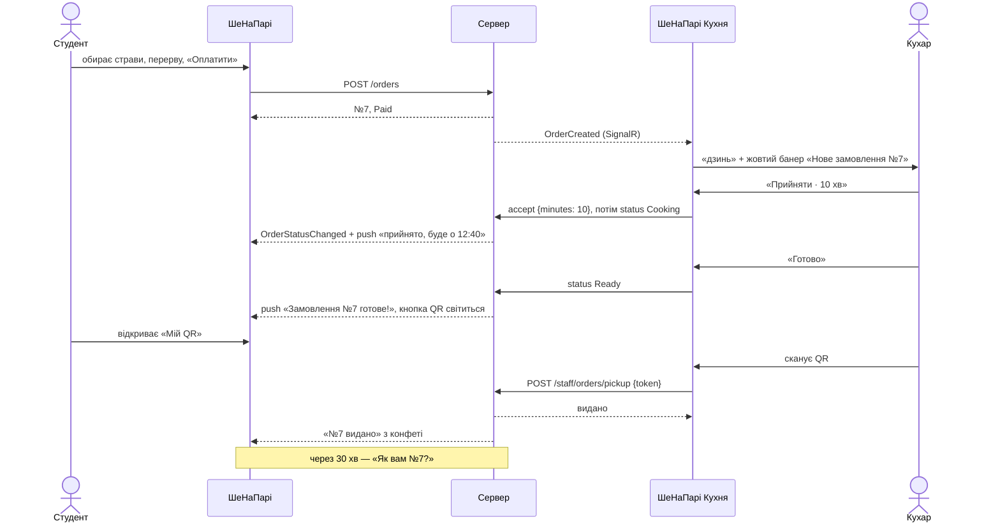

# Сценарії користувачів

[← До README](../README.md)

У системі три ролі людей: **студент** (застосунок ШеНаПарі), **кухар** (застосунок ШеНаПарі Кухня) і **адміністратор** (Swagger). Частину роботи без участі людини виконує **сервер**.

- [Повний шлях замовлення](#повний-шлях-замовлення)
- Студент: [перший запуск і вхід](#с1-перший-запуск-і-вхід) · [замовлення](#с2-замовлення) · [відстеження](#с3-відстеження) · [отримання](#с4-отримання-за-qr) · [скасування](#с5-скасування) · [оцінка](#с6-оцінка) · [історія](#с7-історія) · [профіль і налаштування](#с8-профіль-і-налаштування)
- Кухар: [вхід](#к1-вхід) · [черга](#к2-черга) · [видача](#к3-видача) · [скасування](#к4-скасування-кухнею) · [стоп-лист](#к5-стоп-лист) · [пауза](#к6-пауза-прийому)
- [Адміністратор](#адміністратор)
- [Автоматичні дії сервера](#автоматичні-дії-сервера)

## Повний шлях замовлення

---

## Студент

### С1. Перший запуск і вхід

1. **Онбординг.** Три слайди. На останньому, про сповіщення, кнопка «Увімкнути сповіщення» показує системний запит дозволу; «Пізніше» нічого не питає. Онбординг показується один раз після встановлення.
2. **Номер телефону.** Студент вводить номер у форматі `+380 XX XXX XX XX`. Під кнопкою є посилання на умови використання й політику конфіденційності; вони відкриваються й без входу.
3. **Код з SMS.** Шість цифр. Новий код можна запросити через 60 с. Після 5 невдалих спроб треба запросити новий.
4. **Ім'я.** Лише для нового клієнта: це ім'я кухар називає на видачі.
5. Застосунок сам переходить на **Головну**. Наступного разу сесія відновлюється одразу, без входу.

### С2. Замовлення

1. **Головна.** Привітання на ім'я, жовта картка наступної перерви («через 12 хв, о 11:40») і меню. Фільтри: «Усі», «Популярне» та категорії. Страви, що закінчились, сірі й стоять останніми, з позначкою «Закінчилось» і без «+».
2. **Страва.** Велике фото, опис, вага, КБЖВ з діаграмою, позначки «гостре» й «веган», вибір кількості й кнопка «Додати · 190 ₴».
3. **Кошик.** Кількість кожної страви (1–20) і сума. Кошик зберігається на телефоні між запусками. Якщо страва закінчилась, поки лежала в кошику, застосунок пропонує її прибрати.
4. **Оформлення.** Студент обирає:
   - **коли забрати**: одну з сьогоднішніх перерв (найближча вибрана заздалегідь) або «Якнайшвидше»;
   - **спосіб оплати**: Google Pay або Apple Pay (оплата імітується, гроші не списуються).
5. **«Оплатити».** З'являється «Замовлення №7 оплачено» з галочкою, конфеті й звуком. Під ним, якщо сповіщення вимкнені, з'являється картка з пропозицією їх увімкнути. Якщо студент один раз натиснув «Не треба», картка повернеться не раніше третього замовлення, а після другої відмови більше не з'являється.

**Що може піти не так:**

| Ситуація | Що бачить студент |
|---|---|
| Кухня поставила паузу | на головній банер; кнопка «Оплатити» вимикається наживо, без перезавантаження екрана |
| Обрана перерва вже почалась | помилка, список перерв оновлюється, вибирається найближча |
| Страва закінчилась, поки студент оформлював | застосунок повертає в кошик з оновленим меню |
| Немає мережі | повідомлення про помилку, дані на екрані лишаються |

### С3. Відстеження

- Вкладка **Замовлення → «Активні»** показує замовлення в роботі. Екран замовлення відображає кроки «Оплачено → Прийнято → Готується → Готово» з часом кожного й очікуваним часом готовності.
- Статус оновлюється сам через SignalR; тягнути екран для оновлення не треба.
- На Android приходять push: прийнято (з часом готовності), готове, скасоване кухнею, не забране. Тап по push відкриває замовлення.
- Під дзвіночком на головній лежить стрічка сповіщень з тими самими текстами. Вона працює і на iOS, і з вимкненим push.

### С4. Отримання за QR

1. Коли замовлення готове, кругла кнопка в центрі нижньої панелі починає світитися.
2. **«Мій QR»** відкривається шторкою поверх застосунку. Екран стає максимально яскравим, не гасне, скриншоти й запис екрана заборонені. Великий номер «№7» видно поруч із кодом.
3. Якщо готових замовлень кілька, зверху є чипи «№2 · Готово», «№5 · Готується», а картки гортаються.
4. Кухар сканує код. Шторка показує «№7 видано» з конфеті й звуком «Дзинь на видачу»; якщо чекають інші замовлення, вона переходить до них.

Готове замовлення чекає **30 хвилин**. Потім сервер закриває його як «не забрано» без повернення коштів, а студент отримує сповіщення.

### С5. Скасування

Поки кухня не почала готувати (статуси «Оплачено» або «Прийнято»), на екрані замовлення є кнопка «Скасувати замовлення». Після підтвердження гроші повертаються (у межах імітації). Коли замовлення вже готується, кнопки немає, а сервер відповів би `order.cannot_cancel`.

### С6. Оцінка

1. Через 30 хв після видачі приходить push «Як вам №7?», а на головній з'являється картка з п'ятьма зірками.
2. Тап по зірці відкриває шторку оцінки з уже вибраною кількістю зірок.
3. На 4–5 зірок застосунок пропонує позитивні позначки («Смачно», «Швидко», «Гаряче», «Велика порція», «Без черги»), на 1–3 — скарги («Холодне», «Довго чекав», «Мала порція», «Не те замовлення», «Несмачно»). Можна додати коментар до 500 символів.
4. «Дякуємо!» з анімацією, і шторка зачиняється сама.

Оцінку можна змінити протягом 3 днів на екрані замовлення. Картка на головній зникає після оцінки, «Не зараз», нового замовлення або через 24 години.

### С7. Історія

**Замовлення → «Історія»**: завершені замовлення, згруповані за місяцями, із заголовком на кшталт «Листопад · 3 замовлення · 290 ₴». Фільтри: «Усі», «Отримані», «Скасовані», «Не забрані». Наступні замовлення довантажуються під час прокручування.

### С8. Профіль і налаштування

Вкладка **«Більше»**:

| Розділ | Що там |
|---|---|
| Мій профіль | зміна імені; телефон показано, але змінити його не можна, бо це логін; вихід |
| Налаштування | push про замовлення (зберігається на сервері), дозвіл на сповіщення в системі, мова (системна, українська, англійська), тема (системна, світла, темна), «Вимкнути анімації», звуки, видалення акаунта |
| Питання та відповіді | короткі відповіді про замовлення, видачу, скасування й оплату |
| Підтримка | Telegram і пошта; якщо застосунку для них немає, контакт копіюється |
| Документи | умови використання, політика конфіденційності, умови повернення коштів; доступні й без мережі (кеш або копія в застосунку) |

**Видалення акаунта** можливе, лише коли немає активних замовлень. Ім'я й телефон стираються, сесії завершуються, а замовлення лишаються в статистиці їдальні знеособленими.

---

## Кухар

### К1. Вхід

Email і пароль, які видав адміністратор. Сам зареєструватися кухар не може. Вимкнений акаунт втрачає доступ одразу, навіть з дійсним токеном.

### К2. Черга

Основний пристрій — планшет горизонтально, три колонки:

| Колонка | Замовлення | Дія на картці |
|---|---|---|
| **Нові** | оплачені | «Прийняти · 5 / 10 / 15 / 20 хв» (одразу переводить у «Готується») |
| **Готуються** | прийняті й ті, що готуються | «Готово» |
| **Готові** | чекають на клієнта | «Видати без QR» з підтвердженням; звичайна видача у вкладці «Видача» (див. К3) |

- Кожне нове замовлення супроводжує звук і жовтий банер з номером. На вкладці «Черга» є лічильник нових.
- На картці: номер, коли потрібно («⚡ Якнайшвидше» або «Перерва 11:40»), що готувати, таймери («ще 7 хв», «чекає 24 хв»). Готове замовлення, що чекає надто довго, червоніє.
- Замовлення відсортовані за тим, коли їх треба віддати: «якнайшвидше» за часом створення, решта за початком перерви.
- Фільтри: «Усі», «Якнайшвидше» та окремо кожна перерва.
- Тап по картці відкриває деталі: склад, ім'я клієнта, сума, історія статусів і кнопка «Скасувати». Її винесено з картки, щоб мокрий палець не натиснув її випадково.
- На телефоні той самий інтерфейс показує один статус за раз з перемикачем угорі.

### К3. Видача

Вкладка **«Видача»**: камера постійно шукає QR, поруч клавіатура для номера.

- **QR-код**: замовлення видається одразу, бо сервер перевіряє код. Зелена картка «№7 видано» і звук. Той самий код, повторно побачений протягом 4 с, ігнорується.
- **Номер замовлення** (якщо QR не працює): кухар вводить «7» → бачить «Готове · Влад» → «Видати №7». Так можна звірити ім'я.
- **Помилки**: «Це не код ШеНаПарі», «Немає замовлення з таким номером», «№7 ще не готове», «Замовлення вже видано».
- **Видати без QR**: кнопка на картці готового замовлення в черзі, коли телефон клієнта розрядився.

### К4. Скасування кухнею

У деталях замовлення є кнопка «Скасувати». Кухар обирає причину, яку побачить клієнт: «Закінчились продукти» (вибрана заздалегідь), «Кухня перевантажена», «Технічна проблема» або «Інша причина…» з власним текстом. Скасувати можна й замовлення, яке вже готується. Гроші повертаються автоматично, клієнт отримує push з причиною.

### К5. Стоп-лист

Вкладка **«Стоп-лист»**: усі страви за категоріями, кожна плитка — перемикач. Вимкнена страва показана закресленим сірим текстом з позначкою «закінчилось». Зміна застосовується одразу; якщо сервер відмовив, перемикач повертається назад. У клієнтів страва миттєво сіріє (подія `MenuChanged`). Є пошук і кнопка «Увімкнути все» для ранку.

### К6. Пауза прийому

Перемикач «Приймаємо / Пауза» в заголовку видно на всіх вкладках. Після підтвердження нові замовлення не приймаються, а червоний банер показує, з якого часу пауза. Вже прийняті замовлення паузу не зачіпає. Клієнти бачать банер на головній, і кнопка «Оплатити» у них вимикається наживо. Пауза синхронізується між пристроями кухні: якщо поставити її на планшеті, телефон біля видачі теж її покаже.

---

## Адміністратор

Окремого застосунку немає: адміністратор працює в **Swagger UI** (`/swagger`).

1. `POST /auth/staff/login` → скопіювати `accessToken` → **Authorize**.
2. **Меню**: створити категорію, додати страву з цінами й КБЖВ, завантажити фото (`POST /admin/dishes/{id}/image`), заповнити англійські назви. Клієнти отримують зміни відразу.
3. **Розклад**: створити розклад перерв (наприклад, на сесію) й активувати. Перерви на тиждень перебудуються, а ті, на які вже є замовлення, лишаться.
4. **Персонал**: створити кухаря, змінити йому пароль, вимкнути акаунт працівника, що звільнився. Створювати адміністраторів може лише суперадмін.
5. **Звіт за день**: `GET /admin/orders?date=…` повертає всі замовлення дня з історією статусів.

---

## Автоматичні дії сервера

| Коли | Що відбувається |
|---|---|
| Щогодини і під час старту | бракуючі перерви з активного розкладу створюються на 7 днів уперед |
| Щохвилини | готові замовлення, що чекають понад 30 хв, стають «не забрано» (без повернення коштів, зі сповіщенням) |
| Щохвилини | замовленням, виданим понад 30 хв тому (але не пізніше ніж 24 год), один раз надсилається «Як вам №…?» |
| Кожна зміна статусу | запис в історії, сповіщення в стрічці, подія SignalR, push (якщо потрібен і дозволений) |
| Push на «мертвий» пристрій | FCM повідомляє, що токен недійсний, і сервер його забуває |
